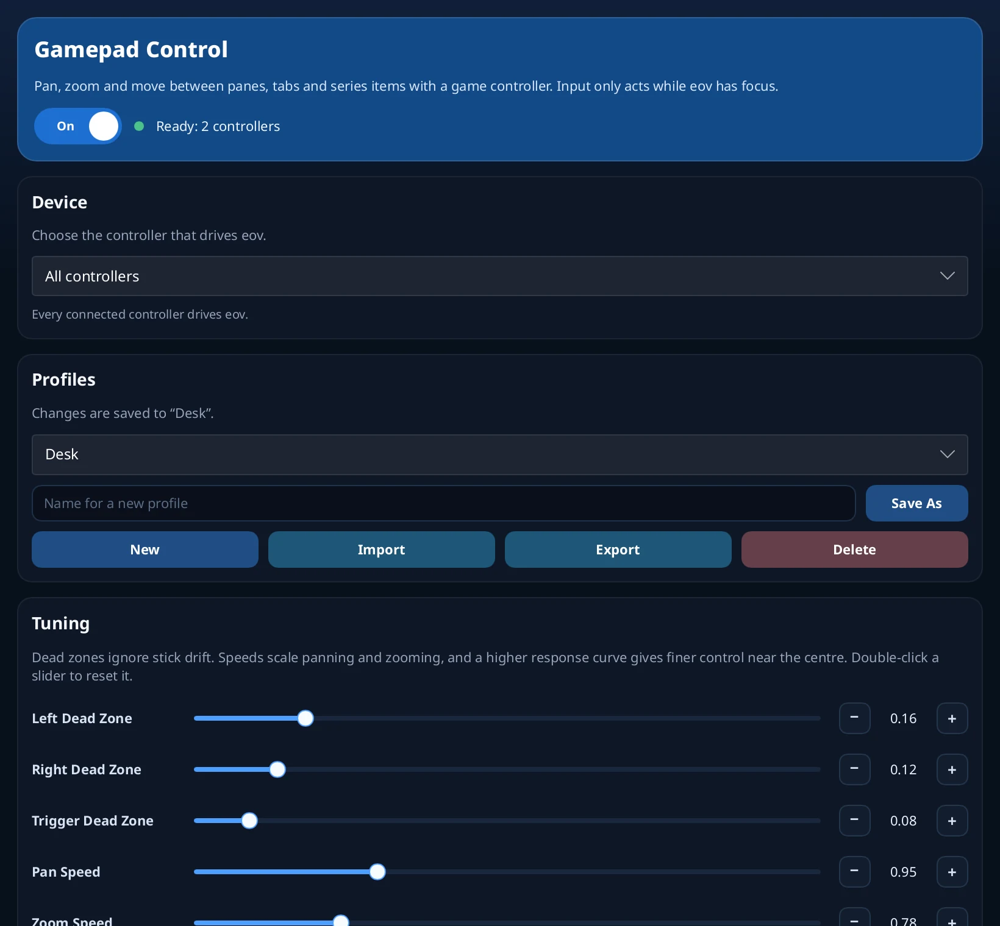

# Gamepad Plugin for eov

[](https://github.com/eosin-platform/eov-gamepad-plugin/actions/workflows/ci.yml)
[](https://github.com/eosin-platform/eov-gamepad-plugin/actions/workflows/release.yml)
[](https://github.com/eosin-platform/eov-gamepad-plugin#license)

This plugin lets you drive [eov](https://github.com/eosin-platform/eov), the
whole-slide image viewer, with a game controller: pan and zoom the slide,
switch panes and tabs, and step through a series. A settings window, opened
from the toolbar, holds dead zones, speeds, mappings and saved profiles.

Version 1.0 targets eov 1.0 (plugin API 1.0). Release packages (`.eop`) are
built for Linux, macOS and Windows on `x86_64` and `arm64`.

<p align="center">
	
</p>

## Installing

From the official catalog:

```bash
eov plugin install gamepad
```

Or from a downloaded package:

```bash
eov plugin install ./gamepad-v1.0.0-linux-x86_64.eop
```

Then restart eov. The plugin adds a **Gamepad** button to the toolbar.

## Using it

Connect a controller by USB or Bluetooth and use it while eov has focus. The
default layout:

| Control | Action |
|---|---|
| Left stick | Pan |
| Right stick up / down | Zoom in / out |
| Right trigger / left trigger | Zoom in / out (pressure sensitive) |
| D-pad left / right | Previous / next pane |
| D-pad up / down | Previous / next tab |
| North button (Y, △) | Show or hide the series bar |
| Left / right shoulder | Previous / next series item |
| South button (A, ✕) | Open the selected series item |
| East button (B, ○) | Fit the slide to the pane |
| Start | Pause or resume controller input |
| Select | Show or hide the settings window |

Every control can be remapped. Sticks and triggers offer pan, zoom and
pointer actions; buttons offer the navigation actions, Fit View, Zoom In or
Out (zooms while held; a tap zooms a step), the settings window and
Enable / Pause.

Motion applies to the focused pane:

- Panning and zooming are relative and scaled by elapsed time, so the speed
  does not depend on how often the controller reports or on the frame rate.
  At speed 1, full deflection pans twice the pane's longer side per second
  and zooms by a factor of 20 per second.
- Sticks use a radial dead zone with rescaling: inside it nothing moves,
  and just outside it motion starts from zero. Diagonals keep their
  direction. The response curve (1 = linear) gives finer control near the
  centre.
- Triggers read from released (0) to fully pressed (1) on every controller,
  whether it reports them as analog buttons or as axes.

### Focus, pausing and system-wide effects

- Controller input only acts while eov has keyboard focus: its main window
  or the gamepad settings window. Using the controller in another
  application does nothing in eov, and with two eov windows open only the
  focused one reacts.
- **Enable / Pause** (the switch in the window, or Start by default) stops
  every action except Enable / Pause itself. While paused, the status bar
  shows "Gamepad paused".
- Nothing outside eov is touched by default. The *System Pointer* option
  (off by default) lets "Move Pointer" mappings move the system pointer
  while eov has focus. Turning it on asks the system for permission:
  - Wayland: the Remote Desktop portal asks once; the grant is remembered.
  - X11: no prompt (XTest).
  - macOS: eov needs Accessibility access (System Settings › Privacy &
    Security › Accessibility). This applies to the whole eov process.
  - Windows: no prompt.

  If the permission is declined, the option turns itself off again.

### Settings window

- **Device**: *All controllers* (the default) takes input from every
  connected controller; with several, each stick and trigger follows the
  controller that deflects it most, so drift on an idle pad is not added.
  Choosing one controller ignores the others. Identical controllers are
  listed separately, and the choice is remembered; while the chosen
  controller is disconnected, every controller works.
- **Profiles**: changes are saved automatically. When a profile is
  selected, changes are also saved into that profile (never into another).
  *Save As* stores the current settings under the typed name, *New* stores
  the defaults, *Import* and *Export* read and write profile files (JSON, also
  those of 0.x), and *Delete* removes the selected profile. Replacing or
  deleting a profile asks first. *No profile* keeps the settings but stops
  saving them into a profile.
- **Tuning**: dead zones, pan and zoom speed and the response curve. Drag a
  slider or use the step buttons; double-click a slider to reset it.
- **Mappings**: an action for each stick axis, trigger and button.

## Settings storage

The plugin keeps its settings in eov's per-plugin settings store, written
atomically by eov (`<eov data dir>/plugins/gamepad/settings.json`, for
example `~/.local/share/eov/plugins/gamepad/settings.json` on Linux). Changes
are written shortly after they are made, not on every slider movement.

On the first start of 1.0, settings and profiles saved by 0.x (under
`~/.config/eov/plugins/gamepad/` on Linux) are imported once. The old files
are left untouched. Pointer mappings are kept, but system pointer control
starts off.

## Platform and packaging notes

- **Linux** reads controllers through evdev and udev (`libudev`). The
  logged-in user can usually read game controllers; if not, add a udev rule
  for the controller or add the user to the `input` group.
- **Flatpak**: the sandbox must expose input devices. eov's Flatpak manifest
  needs `--device=input` in `finish-args` (Flatpak 1.15.6 or newer; older
  versions need `--device=all`). Without it the plugin explains this in its
  window and in a notification. Users can grant it themselves:

  ```bash
  flatpak override --user --device=input io.eosin.eov
  ```

  System pointer control uses the Remote Desktop portal, which needs no
  extra permission.
- **macOS** reads controllers through IOKit; controllers normally need no
  permission.
- **Windows** reads controllers through Windows.Gaming.Input, which only
  reports input while eov is in the foreground.

eov publishes window focus changes with its next frame. When controller
input starts, the plugin asks eov for a frame, so after switching back to eov
the first input may take a frame to be recognised.

## Building

The crate builds on its own; it needs the `eov-plugin-api` crate of eov at
`../../plugin_api`, which is where it is inside an eov checkout:

```bash
# inside an eov checkout
cargo build --release --manifest-path plugins/gamepad/Cargo.toml
```

Outside eov, check out eov at the release named by
`[package.metadata.eov] ref` in `Cargo.toml` so that its `plugin_api`
directory is two levels up. CI and release builds do exactly that, instead of
building against eov's default branch.

Linux builds need `libudev-dev` and `pkg-config`.

## Packaging

An `.eop` is a tar archive with `plugin.toml`, the library (named after the
plugin id: `libgamepad.so`, `libgamepad.dylib` or `gamepad.dll`) and the
`ui/` directory:

```bash
cargo build --release
python3 scripts/package_eop.py --output dist/gamepad.eop
```

Without `--library` the script uses the release build for the current
platform; `--library` takes any other build. The archive is reproducible
(sorted entries, fixed owners and modes, `SOURCE_DATE_EPOCH` timestamps).

## Development

```bash
cargo fmt --check
cargo clippy --all-targets --locked -- -D warnings
cargo test --locked
python3 -m unittest discover -s scripts -p 'test_*.py'
```

The tests need no controller and never touch the home directory:

- the input engine (dead zones, curves, triggers, timing, gating,
  debouncing, several controllers) is a pure state machine with unit tests;
- the plugin runs in `eov_plugin_api::testing::TestHarness` with scripted
  controller input;
- a contract test compiles `ui/gamepad-window.slint` with the Slint version
  eov uses and checks every property the plugin pushes and every callback it
  handles. Building it needs `libfontconfig1-dev` on Linux.

Source layout:

| Path | Contents |
|---|---|
| `src/plugin.rs` | The `Plugin` implementation: events, the settings window, profiles |
| `src/engine.rs` | Input engine: device state, gating, dead zones, motion |
| `src/backend.rs` | Controller input through gilrs (and the scripted test backend) |
| `src/worker.rs` | The input thread: waits for input, calls eov, writes settings |
| `src/config.rs` | Controls, actions, tuning ranges, persisted format, profile names |
| `src/shared.rs` | State shared between the UI thread and the plugin's threads |
| `src/ui.rs` | Properties pushed to the settings window |
| `src/pointer.rs` | Opt-in system pointer control |
| `src/environment.rs` | Explanations when controllers cannot be read (Flatpak, permissions) |
| `src/legacy.rs` | One-time import of 0.x settings |
| `ui/gamepad-window.slint` | The settings window |
| `scripts/` | Packaging and release tooling |

The input thread blocks until the controller reports something or a timer is
due, so an idle controller costs nothing. It calls eov's non-blocking host
methods directly and never holds a lock while doing so; the settings window
is only updated on eov's UI thread.

## Releasing

`scripts/dispatch-release-workflow.sh <version>` starts the release workflow
for a version that matches `Cargo.toml` and `plugin.toml`. It builds every
platform against the pinned eov release, publishes the `.eop` files with
checksums and writes `release.toml` for eov's plugin catalog.

## Not implemented

Clicking or scrolling with the system pointer, held-button repeat for
navigation actions, button chords, automatic per-controller profiles and
force feedback.

## License

This repository is tri-licensed under:

- MIT
- Apache-2.0
- GPL-3.0

See the license files in this repository for the full text.
